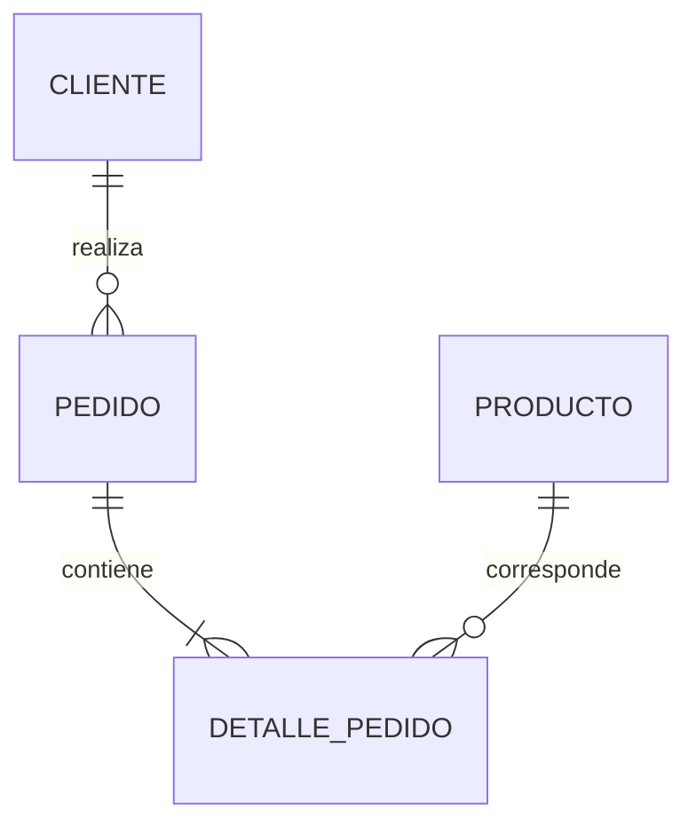

# Sistema de Gestión de Pedidos

**APF2 · Semana 10 — Propuesta académica para distribuidores de Alicorp.**

Adaptación de `tiendaaaLibros`: se mantiene el enfoque de controladores, servicios, DTO y pruebas, y se reemplaza por completo el dominio de libros/revistas por productos, clientes y pedidos. El catálogo, los precios, los RUC y los usuarios incluidos son datos ficticios para demostración; este proyecto no se conecta con sistemas de Alicorp.

## 1. Problema y contexto

El sistema está dirigido a un equipo comercial que recibe pedidos de distribuidores. Su necesidad es registrar quién solicita productos, conservar las cantidades y los precios acordados, consultar los pedidos pendientes y actualizar las existencias al confirmar la operación.

Un administrador mantiene el catálogo y los clientes. El personal de ventas prepara, modifica y confirma pedidos. Un usuario de consulta revisa información sin modificarla. El sistema impide confirmar pedidos sin stock y devuelve las unidades al cancelar una confirmación. Así, los datos del pedido y el inventario permanecen consistentes incluso si una operación falla o dos usuarios intentan comprar las últimas unidades simultáneamente.

## 2. Ejecutar en Windows

Requisitos: **JDK 21 o superior** y acceso a Internet en la primera compilación. Verificado con JDK 25. Spring Boot 4.1.1 y Maven Wrapper están configurados en el proyecto.

1. Extraer el ZIP y abrir la carpeta `SistemaGestionPedidos`.
2. Abrir PowerShell en esa carpeta.
3. Ejecutar:

```powershell
java -version
.\mvnw.cmd spring-boot:run
```

Abrir **http://localhost:8080**. También se puede ejecutar `iniciar.cmd` con doble clic. En NetBeans, abrir esta carpeta como proyecto Maven y ejecutar el objetivo `spring-boot:run`.

| Usuario local | Contraseña de demostración | Rol |
| --- | --- | --- |
| `admin` | `Admin123!` | ADMIN |
| `ventas` | `Ventas123!` | VENTAS |
| `consulta` | `Consulta123!` | CONSULTA |

La primera ejecución carga tres productos de ejemplo y un distribuidor si las tablas correspondientes están vacías. No crea pedidos automáticamente.

### Base de datos persistente incluida

La configuración predeterminada utiliza **H2 relacional en disco**, en `data/pedidos.mv.db`. No utiliza repositorios de colecciones Java ni una base en memoria para la aplicación. Los datos se conservan al detener y volver a iniciar el sistema. Ejecutar siempre desde la misma carpeta para conservar la misma ruta de datos.

Solo el perfil `test` utiliza una H2 en memoria aislada, que se recrea para las pruebas. Los tests no borran la base normal de la aplicación.

### Compilar el ejecutable

```powershell
.\mvnw.cmd clean verify
java -jar target/sistema-gestion-pedidos.war
```

Se usa un **WAR ejecutable** para incluir las páginas JSP. Se ha diseñado y verificado para ejecutarse con Tomcat embebido mediante esos comandos. No hace falta instalar Tomcat por separado.

Si el puerto 8080 está ocupado:

```powershell
.\mvnw.cmd spring-boot:run "-Dspring-boot.run.arguments=--server.port=8081"
```

## 3. Alcance y recursos

| Recurso | Datos principales | Funciones |
| --- | --- | --- |
| Producto | SKU, nombre, categoría, precio, stock | CRUD completo y búsqueda por nombre/SKU |
| Cliente distribuidor | RUC, razón social, correo, teléfono, dirección | CRUD completo |
| Pedido | Cliente, fecha, estado, detalle de productos y total | CRUD de borradores, consulta, confirmación y cancelación |

El detalle es una entidad interna del pedido; no tiene un CRUD independiente. Cada línea conserva cantidad y precio unitario. El servidor calcula el total con `BigDecimal`; no acepta un total enviado por el cliente.

Incluido: interfaz web, API REST, persistencia, roles, JWT, validaciones y control transaccional de stock.

Fuera de alcance: facturación electrónica/SUNAT, pagos, reparto, promociones, gestión de usuarios desde una pantalla e integración con sistemas reales de Alicorp. El RUC se valida como 11 dígitos; no se consulta su existencia en SUNAT. Los importes de ejemplo no implementan un cálculo tributario.

## 4. Modelo y arquitectura



Todas las entidades se encuentran en `model/`; los controladores intercambian DTO, no entidades JPA.

```text
API REST + JWT
  Controller → Service → Repository / JpaClienteDao → JPA/Hibernate → BD

Pantallas MVC
  JSP + JSTL/EL + Bootstrap → WebController → Service → persistencia

CRUD de clientes con JDBC
  JSP → WebController → ClienteService → JdbcClienteDao → JdbcTemplate → BD

Formulario JSF
  cliente.xhtml → ClienteBean → ClienteService → JdbcClienteDao → misma BD
```

Los dos bloques de la rúbrica piden tecnologías distintas. Para evidenciar ambos, `ClienteDao` tiene dos adaptadores: `JpaClienteDao` para la API y `JdbcClienteDao` para las pantallas de clientes. **Ambos reutilizan la misma clase `ClienteService`, sus validaciones y la misma tabla.** Se seleccionan mediante configuración e inyección por constructor. No hay SQL en controladores, JSP ni Managed Beans.

`JdbcTemplate` usa JDBC con sentencias parametrizadas y `PreparedStatement` para la inserción. Las transacciones de Spring incluyen las conexiones de ese mismo `DataSource`. El resto de las operaciones del dominio utiliza repositorios JPA.

Las JSP usan JSTL y Expression Language. Las directivas `<%@ page ... %>` y `<%@ taglib ... %>` declaran codificación y bibliotecas; no son scriptlets Java. El formulario JSF tiene un bean administrado por Spring (`@Component` y `@RequestScope`) integrado mediante JoinFaces y `SpringBeanFacesELResolver`, compatible con Jakarta Faces moderno.

## 5. Reglas de negocio y transacciones

- SKU y RUC únicos, campos obligatorios, correo válido, precio positivo con hasta dos decimales y stock no negativo.
- Un pedido requiere un cliente existente y de 1 a 50 productos distintos, con cantidades de 1 a 10 000. La interfaz web admite hasta cuatro líneas; la API admite hasta 50.
- Crear un pedido genera un **BORRADOR** sin descontar stock. Solo los borradores pueden editarse.
- Confirmar un pedido bloquea el pedido y los productos en orden de ID, verifica stock y descuenta todas sus líneas dentro de una transacción.
- Si la segunda línea no tiene stock, se revierte también el descuento de la primera y el pedido continúa en borrador.
- Dos confirmaciones que compiten por stock no pueden vender las mismas unidades. Una segunda confirmación del mismo pedido se rechaza.
- Cancelar un pedido confirmado devuelve su stock una sola vez. Cancelar un borrador no modifica inventario.
- No se elimina un pedido confirmado: debe cancelarse primero. Los productos/clientes vinculados a pedidos no se pueden eliminar.
- Los precios guardados en un pedido no cambian al modificar después el catálogo. Editar un borrador vuelve a calcular sus líneas con los precios actuales.

El caso de rollback se implementa en `PedidoService.confirmar`. Usa `@Transactional` y bloqueos `PESSIMISTIC_WRITE`. El test `rollbackRevierteDescuentoPrevioSiOtraLineaNoTieneStock` lee nuevamente la base después del error, sin una transacción externa que oculte el resultado real.

## 6. Consulta JPQL útil

`PedidoRepository.filtrar` permite obtener los pedidos de un distribuidor por estado:

```sql
select p from Pedido p
where (:clienteId is null or p.cliente.id = :clienteId)
  and (:estado is null or p.estado = :estado)
order by p.id desc
```

Ejemplo: `GET /api/pedidos?clienteId=1&estado=CONFIRMADO`.

También existe una búsqueda JPQL de productos por nombre o SKU: `GET /api/productos?texto=aceite`.

## 7. Seguridad

| Operación | ADMIN | VENTAS | CONSULTA |
| --- | --- | --- | --- |
| Consultar API de productos, clientes y pedidos | Sí | Sí | Sí |
| Crear/editar productos y clientes | Sí | No | No |
| Crear/editar/confirmar/cancelar pedidos | Sí | Sí | No |
| Eliminar registros | Sí | No | No |
| Formulario web de clientes y formulario JSF | Sí | No | No |

La API tiene una cadena de seguridad **sin sesión** y requiere `Authorization: Bearer <token>`. El login emite JWT firmados con HS256, emisor `sistema-gestion-pedidos`, rol y vencimiento de 30 minutos. Se rechazan tokens inválidos o vencidos. Las contraseñas se comparan con BCrypt.

Las pantallas JSP/JSF utilizan login por sesión y protección CSRF. Esto permite enviar formularios sin guardar JWT en el navegador. Una sesión web no autentica automáticamente la API: la API sigue requiriendo Bearer.

Los tres usuarios de demostración se configuran en memoria, por separado de los datos del negocio, que sí son persistentes. Pueden cambiarse sus claves mediante `ADMIN_PASSWORD`, `VENTAS_PASSWORD` y `CONSULTA_PASSWORD`. `JWT_SECRET` requiere al menos 32 bytes. El perfil `prod` exige esas variables y la conexión de base de datos; además desactiva los datos de ejemplo y requiere HTTPS para la cookie de sesión.

## 8. Matriz de endpoints

Base: `http://localhost:8080`. Todos los endpoints salvo el login requieren JWT.

| Método | URI | Entrada | Respuesta | HTTP correcto |
| --- | --- | --- | --- | --- |
| POST | `/api/auth/login` | `username`, `password` | Token, roles y duración | 200 |
| GET | `/api/productos` | `texto` opcional | Lista de productos | 200 |
| GET | `/api/productos/{id}` | ID | Producto | 200 |
| POST | `/api/productos` | ProductoRequest | Producto y Location | 201 |
| PUT | `/api/productos/{id}` | ID + ProductoRequest | Producto actualizado | 200 |
| DELETE | `/api/productos/{id}` | ID | Sin contenido | 204 |
| GET | `/api/clientes` | Ninguna | Lista de clientes | 200 |
| GET | `/api/clientes/{id}` | ID | Cliente | 200 |
| POST | `/api/clientes` | ClienteRequest | Cliente y Location | 201 |
| PUT | `/api/clientes/{id}` | ID + ClienteRequest | Cliente actualizado | 200 |
| DELETE | `/api/clientes/{id}` | ID | Sin contenido | 204 |
| GET | `/api/pedidos` | `clienteId`, `estado` opcionales | Lista de pedidos | 200 |
| GET | `/api/pedidos/{id}` | ID | Pedido con detalles | 200 |
| POST | `/api/pedidos` | PedidoRequest | Borrador y Location | 201 |
| PUT | `/api/pedidos/{id}` | ID + PedidoRequest | Borrador actualizado | 200 |
| POST | `/api/pedidos/{id}/confirmar` | ID | Pedido confirmado | 200 |
| POST | `/api/pedidos/{id}/cancelar` | ID | Pedido cancelado | 200 |
| DELETE | `/api/pedidos/{id}` | ID | Sin contenido | 204 |

Errores: **400** datos/formato inválidos; **401** sin autenticación válida; **403** rol insuficiente; **404** registro inexistente; **409** duplicado, stock insuficiente, estado incompatible o registro referenciado.

### Ejemplos JSON

Login:

```json
{"username":"admin","password":"Admin123!"}
```

ProductoRequest:

```json
{"sku":"ALI-004","nombre":"Harina 1 kg","categoria":"Alimentos","precio":5.90,"stock":100}
```

ClienteRequest:

```json
{"ruc":"20999999995","razonSocial":"Distribuidora Ejemplo","email":"ventas@example.com","telefono":"999888777","direccion":"Av. Ejemplo 123, Lima"}
```

PedidoRequest, usando los IDs reales de los registros creados:

```json
{"clienteId":1,"items":[{"productoId":1,"cantidad":3},{"productoId":2,"cantidad":5}]}
```

## 9. Tests y Postman

```powershell
.\mvnw.cmd test
```

Se incluyen **77 tests**: 6 de servicios y 71 casos de integración/contrato HTTP, incluidos los parametrizados. Cubren persistencia JPA/JDBC, CRUD, JWT firmado, expiración, roles, validación anidada, claves únicas, filtros JPQL, rollback, concurrencia y CSRF. Ver los reportes en `docs/evidencias/`.

Para Postman:

1. Importar `postman/SistemaGestionPedidos.postman_collection.json`.
2. Importar `postman/Local.postman_environment.json` y seleccionar ese entorno.
3. Iniciar la aplicación y comprobar `baseUrl`.
4. Ejecutar **toda la colección en orden** con Collection Runner.

La colección tiene **52 solicitudes y 126 comprobaciones**. Hace login con los tres roles, guarda tokens e IDs, crea datos propios, prueba CRUD/errores/transacciones y al final elimina solamente sus propios registros. No necesita IDs fijos ni una base vacía. Si se interrumpe una ejecución antes de la limpieza, sus registros de prueba pueden quedar guardados.

Prueba adicional de las páginas reales (Python 3 sin bibliotecas externas, servidor iniciado):

```powershell
python scripts/smoke_web.py http://localhost:8080
```

Este script comprueba login de sesión, renderizado JSP, alta/edición JDBC, formulario JSF con ViewState, creación/confirmación/cancelación de pedidos y limpieza de sus registros. No sustituye las pruebas de backend.

### Corrección detectada durante las pruebas

La prueba `pedidoBorradorSePuedeEditarConMismoProducto` detectó una respuesta 409 al editar las líneas de un borrador. Hibernate intentaba insertar la nueva línea antes de borrar la anterior, violando la unicidad pedido/producto. Se corrigió vaciando y sincronizando las líneas antiguas dentro de la misma transacción antes de incorporar las nuevas. La prueba ahora verifica respuesta 200, cantidad y total actualizados, y stock sin descontar. Es un caso concreto que puede explicarse durante la exposición.

## 10. PostgreSQL opcional

El proyecto incluye el driver, el perfil `postgres`, un esquema de referencia y una configuración de Docker. Las verificaciones de esta entrega se realizaron con H2; el perfil PostgreSQL queda preparado, sin afirmar una ejecución que no se realizó.

Si se dispone de Docker:

```powershell
docker compose up -d
.\mvnw.cmd spring-boot:run "-Dspring-boot.run.profiles=postgres"
```

O crear una base `pedidos` en un PostgreSQL existente y configurar:

```powershell
$env:DB_URL="jdbc:postgresql://localhost:5432/pedidos"
$env:DB_USER="pedidos"
$env:DB_PASSWORD="tu_clave"
.\mvnw.cmd spring-boot:run "-Dspring-boot.run.profiles=postgres"
```

Hibernate crea/actualiza las tablas (`ddl-auto=update`) para este avance. `database/postgresql.sql` muestra el esquema equivalente para inspección o creación manual. Cambiar de H2 a PostgreSQL cambia la base utilizada; no copia automáticamente los registros de una base a otra.

## 11. Evidencia para la rúbrica

| Requisito | Dónde mostrarlo |
| --- | --- |
| MVC, DAO y DTO; inyección por constructor | `web/`, `controller/`, `service/`, `dao/`, `dto/` |
| CRUD JDBC en base real | `/clientes`, `JdbcClienteDao`, `ClienteService` |
| Bootstrap, JSTL y EL, sin scriptlets | `src/main/webapp/WEB-INF/views/` y `static/css/` |
| JSF y Managed Bean | `/jsf/cliente.xhtml` y `ClienteBean` |
| JPA/Hibernate y CRUD persistente | `model/`, `repository/`, API de los tres recursos |
| Consulta JPQL útil | `PedidoRepository.filtrar` |
| Operación transaccional | `PedidoService.confirmar` y `cancelar` |
| Roles y JWT | `SecurityConfig`, `AuthController` |
| Tests actualizados | `ServiceTest`, `ApiIntegrationTest` |
| Postman actualizado | Colección y entorno en `postman/` |

## 12. Guion breve de demostración

1. Ingresar como administrador y registrar un cliente desde JSP.
2. Registrar otro cliente desde el formulario JSF y mostrarlo en la lista.
3. Crear/editar un producto y mostrar que los datos se conservan al reiniciar.
4. Ingresar como ventas, crear un borrador y mostrar su total.
5. Confirmar: comprobar el stock descontado. Cancelar: comprobar su devolución.
6. En Postman, demostrar un 403 con CONSULTA y el rollback ante stock insuficiente.
7. Mostrar los tests y ubicar las capas, el DAO JDBC, la consulta JPQL y `@Transactional`.

Referencias de implementación: [Spring Boot y JSP](https://docs.spring.io/spring-boot/3.5/reference/web/servlet.html#web.servlet.embedded-container.jsp-limitations), [JoinFaces 6.1.1](https://docs.joinfaces.org/current/reference/), [Spring Security JWT](https://docs.spring.io/spring-security/reference/servlet/oauth2/resource-server/jwt.html).
